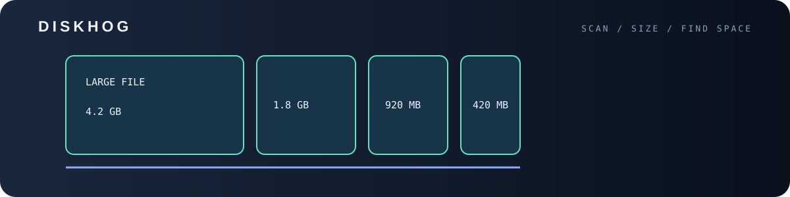

<p align="center">

<p align="center"></p>
  
</p>

<h1 align="center">diskhog</h1>

<p align="center">
  Find the biggest files, folders and duplicates eating your disk.<br>
  Zero dependencies. Python 3.8+. Works on Windows, Linux and macOS.
</p>

---

## Install

```bash
git clone https://github.com/ERROR404DTIR/diskhog.git
cd diskhog
pip install .          # optional: gives you the `diskhog` command
# or just run: python diskhog.py
```

## Usage

```bash
diskhog                         # scan the current folder
diskhog ~/Downloads -n 20       # top 20 rows
diskhog . --min-size 50M        # ignore files smaller than 50 MB
diskhog . --dupes               # also find duplicate files
diskhog . --exclude .git --exclude node_modules
```

### Example output

```text
Scanned /home/me/Downloads: 1204 files, 18.3 GB total

Top 3 biggest files
    6.2 GB  ████████████████████  movies/film.mkv
    2.1 GB  ███████░░░░░░░░░░░░░  backups/db.tar.gz
  850.0 MB  ███░░░░░░░░░░░░░░░░░  iso/ubuntu.iso
```

Duplicates are found by grouping files by size, then comparing SHA-256 hashes,
so only files that are byte-for-byte identical are reported. Symlinks are never followed.

## Tests

```bash
python -m unittest discover -s tests
```

## License

MIT